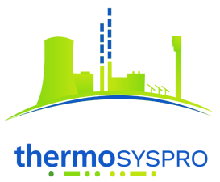

*Warning*: the **ThermoSysPro** official repository has been moved 👉 [official repository](https://github.com/EDF-Lab/ThermoSysPro).

You will find there the last releases 🚀 and you will have a better view of ongoing developments 🏃 and of our roadmap for the future ↗️. Join us on the official repository for any interaction 📞 (see our [contribution guidelines](https://github.com/EDF-Lab/ThermoSysPro/blob/master/ContributionsWorkflow.md)).

 

[ThermoSysPro](https://thermosyspro.com) is an open-source library providing model components for thermal hydraulics, instrumentation and control. It has been developed in the Modelica language from the [Modelica Association](https://www.modelica.org).
